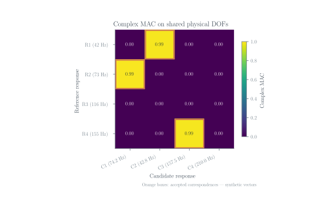
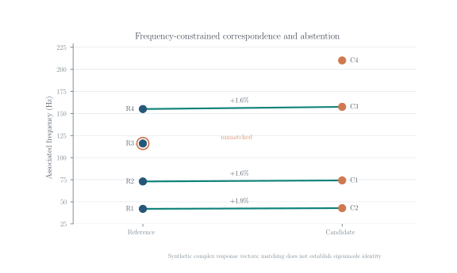

# ModalBridge

**Complex vibration-response correspondence with explicit DOF checks and the option to reject a match.**

ModalBridge compares response shapes recorded under different structural configurations. It aligns vectors by physical degree-of-freedom (DOF) identifiers, computes a complex MAC matrix and proposes frequency-constrained correspondences. A candidate can remain unmatched when the evidence is inadequate. Resonance-response vectors should not be called identified eigenmodes without a separate modal-identification procedure.

**Research software preview · v0.9.2 · Python 3.10–3.13 · MIT**

## Example: why correspondence needs an audit



*Complex MAC for four reference and four candidate synthetic response vectors, evaluated on the same physical DOFs. Outlined cells are accepted correspondences; the third reference has no acceptable candidate.*



*Three accepted links and one deliberately unmatched reference. Percentage annotations show relative frequency shifts for the accepted pairs. The data are synthetic and do not demonstrate structural damage.*

Both figures are made by [`match_modes`](src/modalbridge/core.py). Their input vectors and matching thresholds are available in [`examples/make_readme_figures.py`](examples/make_readme_figures.py).

## Install

From the repository directory:

```bash
python -m pip install -e .
python examples/quickstart.py
```

The quickstart recovers a known permutation of synthetic complex response vectors. To run tests:

```bash
python -m pip install -e ".[dev]"
python -m pytest -q
```

## Compare two measurements

Do not assume matching row numbers in two files indicate the same point on the structure. Each response must refer to a physical point and direction; coordinate systems must be reconciled before comparing vectors.

```bash
modalbridge convert examples/step3_user_data/reference.csv \
  --schema examples/step3_user_data/schema.json --output reference.npz
modalbridge convert examples/step3_user_data/candidate.csv \
  --schema examples/step3_user_data/schema.json --output candidate.npz

modalbridge audit-inputs reference.npz candidate.npz --tolerance-m 0.0001
modalbridge reference.npz candidate.npz --output matches.json
```

The audit checks declared reference frames, common DOF IDs and available coordinates within the chosen tolerance. It is not an automatic registration algorithm. Consult [Data import](docs/USER_DATA_IMPORT.md) for phase conventions, measurement directions and supported NumPy arrays.

## Similarity and matching

For two complex response vectors on the same DOFs, the weighted complex MAC is

$$
\mathrm{MAC}_{rc}=\frac{\left|\boldsymbol{\phi}_r^{H}\mathbf{W}\boldsymbol{\phi}_c\right|^2}{\left(\boldsymbol{\phi}_r^{H}\mathbf{W}\boldsymbol{\phi}_r\right)\left(\boldsymbol{\phi}_c^{H}\mathbf{W}\boldsymbol{\phi}_c\right)}.
$$

The matcher combines $1-\mathrm{MAC}$ with a weighted relative frequency difference, applies explicit MAC and frequency gates, and allows an unmatched alternative in the assignment. A high MAC alone does not prove physical mode identity, and a frequency shift alone is not a damage diagnosis.

## Scope and limitations

- Input: complex shape matrices, associated frequencies and verifiable physical DOF IDs.
- Output: a MAC matrix, relative frequency differences, proposed matches and unmatched/ambiguous statuses.
- Limit: registration and physical mode identity are measurement-specific. The original ETH Zürich and FLOOD measurements and their derived data are **not** bundled here.

Read [Research notes](docs/RESEARCH_NOTES.md) for the distinction between response matching and modal identification, and [FAQ](docs/FAQ.md) for common measurement pitfalls.

## Reproduce the figures

```bash
python examples/make_readme_figures.py
# Optionally use a local LaTeX installation for plot text:
python examples/make_readme_figures.py --latex
```

This produces two vector SVG figures in `docs/figures/` from fixed synthetic inputs. No original measurement files are accessed.

## Citation and license

See [`CITATION.cff`](CITATION.cff) and [`LICENSE`](LICENSE). Cite experimental datasets under their own terms. ModalBridge is a research-stage tool; its API may change before 1.0 and the synthetic examples do not establish experimental identification accuracy.
