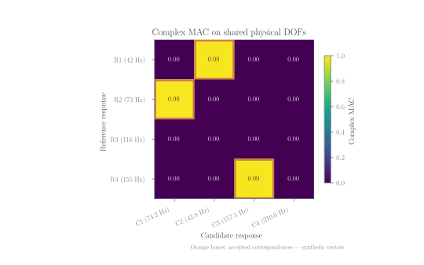
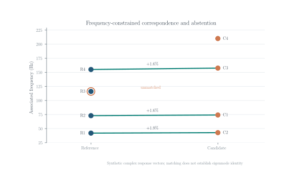

# ModalBridge

**Complex vibration-response correspondence with explicit DOF checks and the option to reject a match.**

[](https://doi.org/10.5281/zenodo.23661623)

ModalBridge compares response shapes recorded under different structural configurations. It aligns vectors by physical degree-of-freedom (DOF) identifiers, computes a complex MAC matrix and proposes frequency-constrained correspondences. The assignment can leave ambiguous candidates unmatched. Input metadata distinguishes resonance responses from independently identified modes.

**Research software preview · v0.9.2 · Python 3.10–3.13 · MIT**

## Example: why correspondence needs an audit



*Complex MAC between four synthetic reference and four candidate vectors on aligned physical DOFs. Outlines indicate accepted correspondences; the third reference remains unmatched.*



*Three accepted correspondences and one unmatched reference in the synthetic example. Labels show relative frequency shifts.*

Both figures are made by [`match_modes`](src/modalbridge/core.py). Their input vectors and matching thresholds are available in [`examples/make_readme_figures.py`](examples/make_readme_figures.py).

## Install

From the repository directory:

```bash
python -m pip install -e .
python examples/quickstart.py
```

The quickstart recovers a known permutation of synthetic complex response vectors. To run tests:

```bash
python -m pip install -e ".[dev]"
python -m pytest -q
```

## Compare two measurements

Assign a physical point and response direction to each row. The two datasets should use the same coordinate reference frame before matching.

```bash
modalbridge convert examples/step3_user_data/reference.csv \
  --schema examples/step3_user_data/schema.json --output reference.npz
modalbridge convert examples/step3_user_data/candidate.csv \
  --schema examples/step3_user_data/schema.json --output candidate.npz

modalbridge audit-inputs reference.npz candidate.npz --tolerance-m 0.0001
modalbridge reference.npz candidate.npz --output matches.json
```

The audit compares reference-frame labels, shared physical DOFs and coordinates within the selected tolerance. The [Data import](docs/USER_DATA_IMPORT.md) guide explains coordinate preparation, phase conventions and NumPy layouts.

## Similarity and matching

For two complex response vectors on the same DOFs, the weighted complex MAC is

$$
\mathrm{MAC}_{rc}=\frac{\left|\boldsymbol{\phi}_r^{H}\mathbf{W}\boldsymbol{\phi}_c\right|^2}{\left(\boldsymbol{\phi}_r^{H}\mathbf{W}\boldsymbol{\phi}_r\right)\left(\boldsymbol{\phi}_c^{H}\mathbf{W}\boldsymbol{\phi}_c\right)}.
$$

The matcher combines $1-\mathrm{MAC}$ with a weighted relative frequency difference. Thresholds define admissible pairs, and the assignment can leave a reference unmatched. Interpret these correspondences alongside the experimental modal identification and structural context.

## Inputs and outputs

- **Input:** complex response or mode-shape matrices, candidate frequencies and physical DOF identifiers.
- **Output:** complex MAC matrix, frequency differences and accepted, unmatched or ambiguous correspondences.
- **Measurement preparation:** align coordinate frames and measurement directions before comparison.

The included examples use synthetic vectors. [Research notes](docs/RESEARCH_NOTES.md) describe experimental data sources; [FAQ](docs/FAQ.md) covers common measurement questions.

## Reproduce the figures

```bash
python examples/make_readme_figures.py
# Optionally use a local LaTeX installation for plot text:
python examples/make_readme_figures.py --latex
```

This generates both SVG figures in `docs/figures/` from the fixed synthetic example.

## Reviewer-driven validation (synthetic, independent truth)

The [validation supplement](docs/REVIEW_VALIDATION.md) documents an intentionally difficult synthetic task with an absent reference shape, a correlated false candidate, 40 seeded realizations and explicit false-acceptance / false-rejection counts. It is **not** experimental evidence of physical modal identity or a comparison against external modal-analysis software.

```bash
python examples/reviewer_benchmark.py --output review_output --seeds 40
python examples/reviewer_scaling.py --output review_output --seeds 40 --repeats 5
```

Report **acceptance coverage together with selective error**: abstaining on hard cases can lower the error among accepted pairs without improving overall correspondence. Under the default MAC gate (0.6), frequency gate (0.2), frequency weight (0.2) and dummy cost (0.6), *every eligible pair costs at most 0.44*. The dummy penalty alone therefore cannot reject an isolated eligible pair. See the [reviewer action matrix](docs/REVIEW_RESPONSE_MATRIX.md) for unresolved experimental and physical-validation requirements.

The [measured-data reanalysis](docs/REAL_DATA_VALIDATION.md) provides source-file hash checks and reproducible comparison commands for the plate, ETH Zürich and FLOOD-SHAB datasets, including a required distinction between the historic FLOOD adapter cost and the package core cost. Original third-party measurements are not bundled.

## Directional measurements and complete plate audit

Use [sensor-frame conversion and line-of-sight checks](docs/SENSOR_FRAMES.md) when a measurement system provides calibrated 3D component axes or laser beam directions. Coordinates and response directions must be transformed consistently; a scalar LDV measurement is not automatically a Cartesian component.

The [complete plate reviewer audit](examples/reviewer_plate_audit.py) exports an eight-reference table, 21-DOF AutoMAC and an optional near-frequency subspace comparison from archived processed complex vectors:

```bash
python examples/reviewer_plate_audit.py \
  --reference without_modes.npz --candidate with_modes.npz \
  --near-reference 3 4 --near-candidate 3 4 --output output/plate
```

The original plate time records, physical mesh and verified motor configuration are **not** reconstructed by this processed-vector audit. See [reviewer evidence status](docs/REVIEW_RESPONSE_MATRIX.md) for these outstanding records.

## Citation and license

**Software authors:** Berkay Kullukcu and Dina Hannebauer. Citation metadata is provided in [`CITATION.cff`](CITATION.cff); license terms are in [`LICENSE`](LICENSE). Cite experimental datasets by their original sources.
